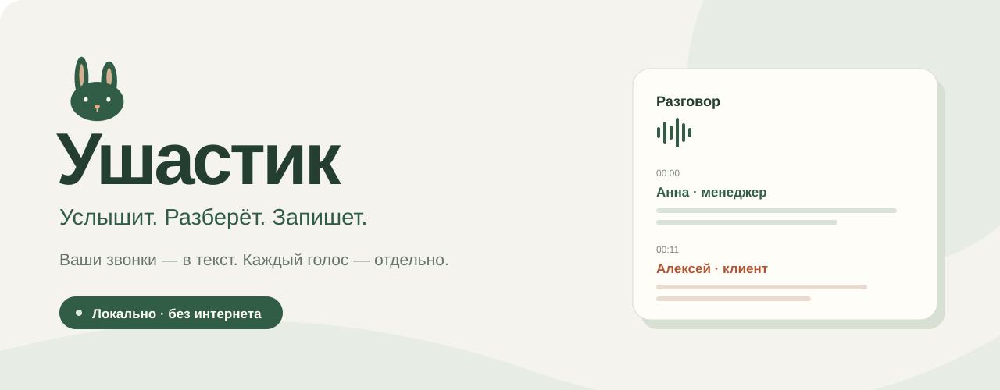
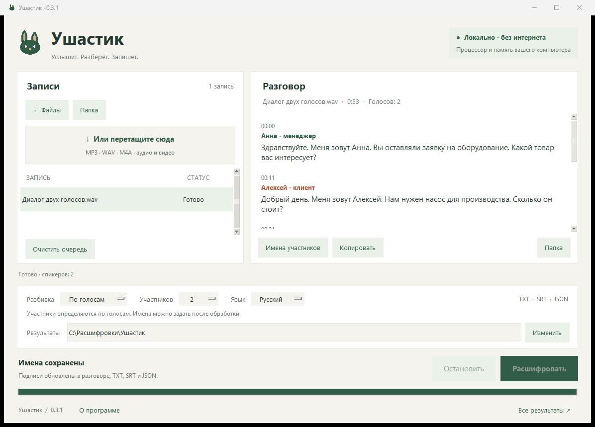

<p align="center">
  
</p>

<p align="center">
  <strong>Записи звонков и встреч → понятный диалог с таймкодами.</strong><br>
  На вашем компьютере. Без интернета, регистрации и подписки.
</p>

<p align="center">
  <a href="https://github.com/kurzemnek/ushastik/releases/latest/download/Ushastik-Windows-x64-0.3.1.zip"></a>
  <a href="https://github.com/kurzemnek/ushastik/releases/latest/download/Ushastik-macOS-Apple-Silicon-0.3.1.zip"></a>
  <a href="https://github.com/kurzemnek/ushastik/releases/latest/download/Ushastik-macOS-Intel-0.3.1.zip"></a>
</p>

<p align="center">
  Версия <strong>0.3.1</strong> · Windows 10/11 x64 · macOS 15+<br>
  Архив около 600 МБ: модели уже внутри. Python и FFmpeg устанавливать не нужно.
</p>

<p align="center">
  
</p>

## Что умеет

| Режим | Когда выбрать |
| --- | --- |
| **По голосам** | Обычная запись разговора. Ушастик определит участников по голосам; для звонка двух человек удобно оставить «Участников: 2». |
| **Два канала** | Стереозапись, в которой каждый собеседник записан в отдельный канал. |
| **Общий текст** | Нужна расшифровка без определения участников. |

Добавляйте несколько записей, целую папку или перетаскивайте файлы в окно. Ушастик обрабатывает очередь последовательно и сохраняет **TXT, SRT и JSON**. Готовый разговор можно прочитать в приложении, скопировать и переименовать участников: например, «Менеджер Анна» и «Клиент Алексей».

Поддерживаются WAV, MP3, M4A, OGG, OPUS, FLAC, AAC, WMA, MP4, WEBM и MKV со звуком. До **90 минут на файл**. Папки просматриваются без вложенных папок.

## Запустить

**Windows.** Скачайте архив и полностью распакуйте его в отдельную папку. Запустите `Ushastik.exe`. Папка `_internal` должна оставаться рядом с программой: в ней находятся модели и библиотеки.

**Mac.** Выберите сборку для своего процессора: Apple Silicon — для M1 и новее, Intel — для Mac с процессором Intel. Обе сборки рассчитаны на **macOS 15 и новее**. Распакуйте архив, перенесите `Ушастик.app` в «Программы» и откройте его.

Mac-сборки имеют локальную подпись **ad-hoc**, без Apple Developer ID и нотариализации Apple. Если macOS блокирует первый запуск, после попытки открытия перейдите в **«Системные настройки» → «Конфиденциальность и безопасность» → «Всё равно открыть»**. Используйте этот способ для архива из данного репозитория, которому доверяете. [Инструкция Apple](https://support.apple.com/en-us/102445).

1. Нажмите **«+ Файлы»**, **«Папка»** или перетащите запись в окно.
2. Выберите разбивку, число участников и язык.
3. При необходимости измените папку результатов кнопкой **«Изменить»**.
4. Нажмите **«Расшифровать»** и выберите готовую запись в очереди.
5. Задайте подписи через **«Имена участников»** или нажмите **«Копировать»**.

Имена обновляются в приложении и во всех трёх файлах результата. Старые расшифровки сохраняются в отдельных папках. Кнопка **«Остановить»** прерывает текущую обработку; запись можно запустить повторно.

## Всё остаётся у вас

Готовое приложение работает без сетевых запросов. Записи и расшифровки никуда не отправляются. Модели включены в архив; API-ключи, аккаунты и отдельная установка FFmpeg не нужны. Нет телеметрии и автоматической проверки обновлений.

Вычисления выполняются на **процессоре и оперативной памяти компьютера**. Скорость зависит от его мощности и длины записи. Текущие сборки используют CPU, включая Mac с Apple Silicon.

Интернет нужен для скачивания дистрибутива и зависимостей при сборке из исходников. После распаковки готового приложения обработка полностью локальная. Уведомление об этом появляется при первом запуске и доступно в разделе **«О программе»**.

## Точность и проверка

Ушастик присваивает голоса внутри одной записи. Имена и роли задаёт человек. Шум, перебивания и короткие реплики могут ухудшать распознавание и разбивку; важные формулировки стоит сверять со звуком.

Проверки включают 30 автоматических тестов обработки слов и спикеров, Windows-прогон и нативную приёмку Mac для обеих архитектур. На Mac собранный обработчик запускался с сетевым запретом на уровне ОС; использовался синтетический русский диалог двух голосов. Это проверка работы приложения, без обещания точности на реальных звонках UIS/CoMagic. [Состав проверок и их границы](docs/VERIFICATION.md).

## Собрать из исходников

Нужны Python 3.11, зависимости из `requirements.txt` и место для моделей и сборки. `fetch_models.py` загружает зафиксированные модели и сверяет SHA-256 на Windows и macOS. Интернет используется только на этапе подготовки.

**Windows, PowerShell:**

```powershell
py -3.11 -m venv .venv
.\.venv\Scripts\python -m pip install -r requirements.txt
.\.venv\Scripts\python fetch_models.py
.\.venv\Scripts\python build_windows.py --model model --speakers speaker-model --work .build/windows --dist dist
```

Результат — `dist/Ushastik/Ushastik.exe` с папкой `_internal`. Собирать нужно Windows Python на Windows.

**Mac, Terminal:**

```bash
python3.11 -m venv .venv
source .venv/bin/activate
python -m pip install -r requirements.txt -c macos/constraints.txt
python fetch_models.py
python build_macos.py
python test_macos_acceptance.py --app dist/Ушастик.app --work acceptance --fixtures fixtures
```

Сборка требует настоящий Mac с macOS 15+, нативный Python 3.11 и Tcl/Tk 8.6. Apple Silicon и Intel собираются отдельно на своей архитектуре. Это две самостоятельные `.app`, без универсального бинарника. В `macos/constraints.txt` зафиксированы совместимые зависимости, включая ONNX Runtime 1.23.2 для Intel. Повторную приёмку запускайте с новой папкой `--work`.

Автоматические тесты:

```bash
python -m unittest test_stitch test_diarization test_engine_boundaries
```

При распространении своей сборки сохраняйте лицензии библиотек и моделей; комплект текстов находится в [`licenses/`](licenses), условия перечислены в [THIRD_PARTY_NOTICES.md](THIRD_PARTY_NOTICES.md).

Для подготовки публичного архива из готового ZIP используйте `tools/package_release.py`. Он добавляет инструкции и `LICENSES`, сохраняя файлы приложения и подпись Mac:

```bash
python tools/package_release.py --platform macos --input build.zip --output release.zip
```

Для Windows укажите `--platform windows`. Исходный архив и существующие результаты не перезаписываются. Архив исходников медиа-компонентов в текущем релизе соответствует его версиям зависимостей; для новой сборки сверяйте их заново.

## Автор и лицензия

**Валерий Курземнек** · [kurzemnek.ru](https://kurzemnek.ru)

Код Ушастика — [MIT](LICENSE). Библиотеки и модели распространяются на собственных условиях: [лицензии компонентов](THIRD_PARTY_NOTICES.md). В распакованном релизе их тексты находятся в папке `LICENSES`.
